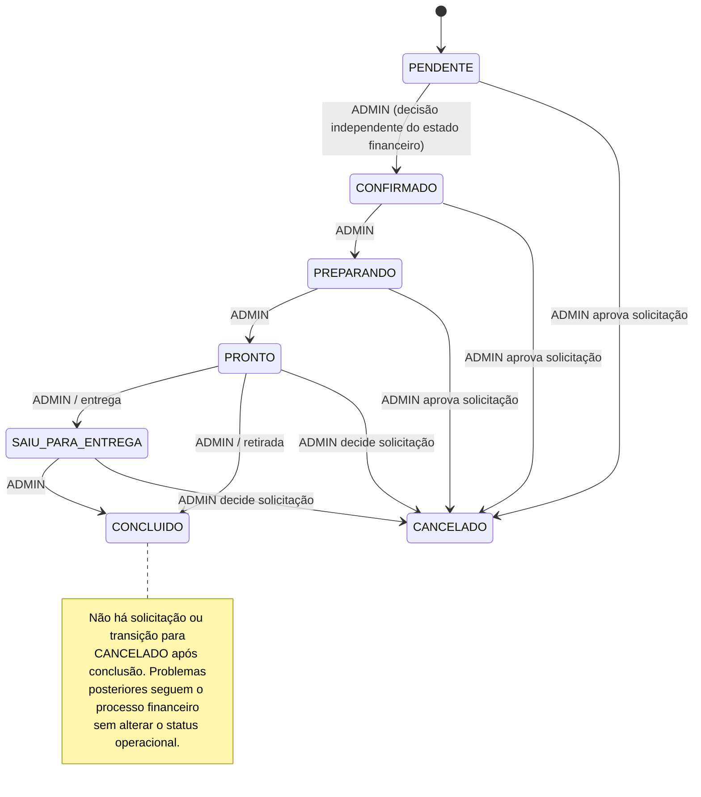
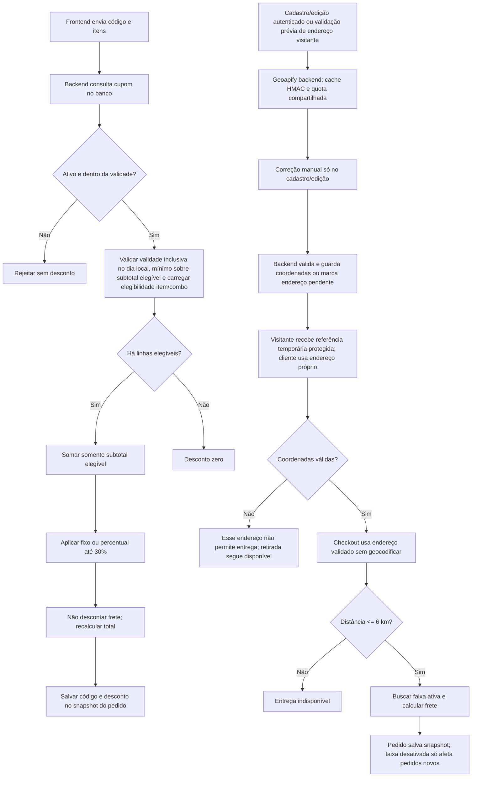
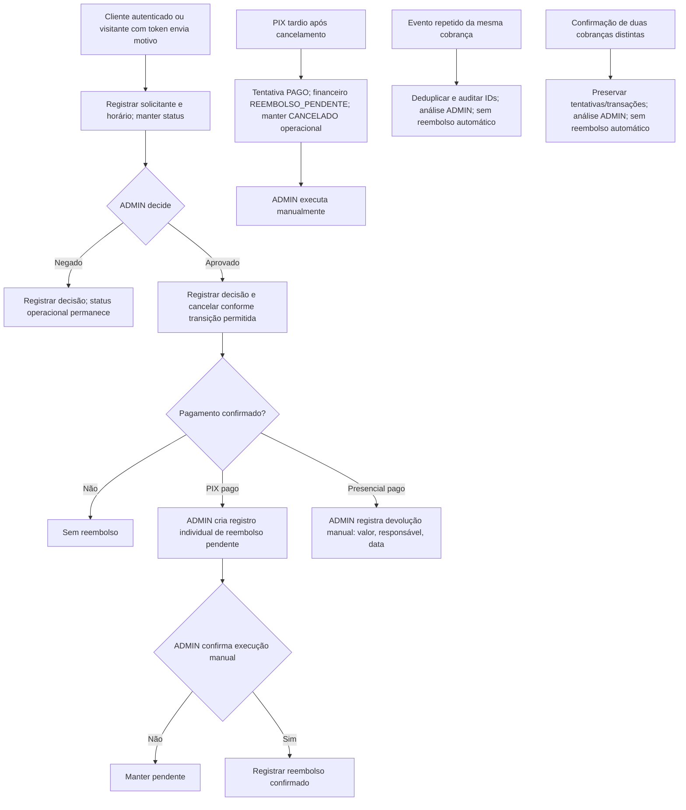
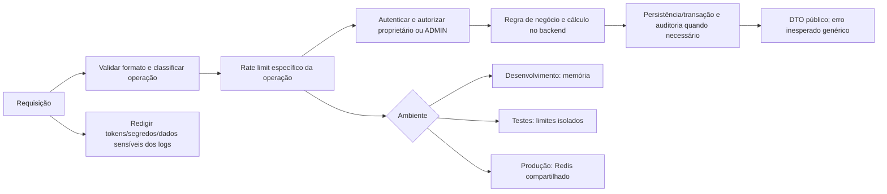

# Mapa de arquitetura e Sprints — LEOSBurger

## Status e dependências

| Sprint | Tema | Dependência/estado |
|---|---|---|
| 01–10 | Fundação, catálogo, autenticação, perfil | Estado conhecido como concluído; conferir documentos e código. |
| 11 | Checkout prévio, adicionais, cupons, Geoapify/faixas | Implementada localmente; antes de produção faltam origem e preços comerciais, validação real do critério/quota/termos Geoapify e rate limit para validação pública. |
| 12 | Criação transacional, snapshots, token visitante | Após 11; migration de campos em `pedidos` precisa ser revisada. |
| 13 | Tentativas, contrato genérico e simulador de pagamento | Após 12; sem provedor real. |
| 14 | Histórico, recuperação e operações de visitante | Após 12–13; token válido enquanto pedido ativo e por 30 dias após conclusão/cancelamento, recuperação número+telefone e permissões limitadas. |
| 15 | Administração, cancelamento e reembolso | Após 12–14; cliente/visitante solicita, ADMIN decide; reembolso é registro individual. |
| 16 | Dashboard e fechamentos | Após 13–15; `America/Sao_Paulo`, semestres civis. |
| 17 | Segurança, integração e desempenho | Após fluxos principais; Redis compartilhado, fail-closed e limites propostos para aprovação. |
| 18 | Preparação de produção | Última; não é integração PIX real nem deploy. |

O backend está em `src/` na raiz. Não existe `backend/src/` nem pasta frontend no repositório inspecionado. As novas rotas previstas devem ficar em `src/routes/`, serviços em `src/services/` quando justificados e testes em `tests/api/`.

## Modelo de dados: atual e proposta

O schema real possui 17 modelos/tabelas após a Sprint 11: oito originais, quatro para endereços/cache/quota Geoapify e cinco para cupons/elegibilidade/usos/faixas. `tentativas_pagamento` e `reembolsos` permanecem aprovados e não implementados. `Pedido` já guarda snapshots de cliente/endereço, valores, distância, taxa e código de cupom; `ItemPedido` guarda nome/preço, adicionais e composição histórica. A criação do pedido ainda precisará persistir tracking, idempotência e snapshot da faixa.

Os diagramas abaixo representam decisões e propostas futuras; não afirmam que endpoints, tabelas ou fluxos já estejam implementados.

### Fluxo de checkout e tentativas de pagamento

```mermaid
sequenceDiagram
    actor Cliente
    participant API as Fastify API
    participant DB as PostgreSQL
    participant Pagamento as Contrato de pagamento

    Cliente->>API: Validar endereço visitante antes do checkout (quando entrega)
    API->>API: Geocodificar endereço e emitir referência autenticada temporária
    API-->>Cliente: Referência protegida do endereço validado
    Cliente->>API: Prévia: itens/combos, adicionais, referência/endereço, modalidade, método e cupom
    API->>DB: Busca preços, adicionais ativos, elegibilidade e faixas
    API->>API: Valida e recalcula subtotal, desconto, distância, frete e total
    API-->>Cliente: Prévia oficial (sem criar pedido)
    Cliente->>API: Criar pedido + Idempotency-Key
    API->>DB: Transação: pedido, linhas/snapshots, tracking hash e idempotência
    DB-->>API: Pedido persistido
    alt PIX
        API->>DB: Criar primeira tentativa idempotente
        API->>Pagamento: Criar cobrança pelo contrato
        Pagamento-->>API: Pendente / aprovada / falha / expirada
        API->>DB: Atualizar tentativa e histórico financeiro
    else Pagamento presencial
        API->>DB: Criar tentativa pendente
    end
    API-->>Cliente: Pedido + estado financeiro; token uma única vez só para visitante
    Note over API,Pagamento: Cada tentativa PIX expira em 5 minutos desde confirmação do backend; máximo 2 por pedido
    opt Segunda tentativa após falha/recusa/expiração
        Cliente->>API: Solicitar segunda tentativa (cliente ou token válido)
        API->>DB: Criar segunda tentativa idempotente e concorrente-segura
        API->>Pagamento: Criar cobrança PIX
        Pagamento-->>API: Resultado da tentativa 2
        API->>DB: Atualizar tentativa e estado financeiro
        Note over API,DB: Expiração da tentativa 2 cancela automaticamente o pedido
    end
    Note over API,Pagamento: Contrato genérico desde o início financeiro; provedor real não escolhido; simulador apenas dev/teste
    Note over API,DB: Token válido enquanto pedido ativo; após conclusão/cancelamento, TTL de 30 dias; recuperação invalida anterior; sem OTP (risco aceito)
    Note over API,Pagamento: Falha/recusa encerra tentativa imediatamente; eventos duplicados da mesma cobrança são deduplicados
    Note over API,Pagamento: PIX tardio após cancelamento: tentativa original PAGO, financeiro REEMBOLSO_PENDENTE, operacional CANCELADO; reembolso manual
```

### Estados operacionais e cancelamento/reembolso



Todas as transições administrativas de status operacional são controladas por ADMIN; a única transição automática é o cancelamento após expiração da segunda tentativa PIX. O cliente/visitante não altera status: solicita cancelamento com motivo e horário, e ADMIN decide. Cancelamento não conclui reembolso. Falha/recusa/expiração da primeira tentativa libera a segunda; pedido pago/cancelado não aceita nova cobrança. Uma confirmação tardia fica ligada à tentativa original. Repetição da confirmação da mesma cobrança é distinta de duas cobranças diferentes confirmadas; ambas são auditadas e encaminhadas à análise ADMIN sem reembolso automático.

Todas as transições operacionais são controladas por ADMIN, exceto cancelamento automático aprovado após expiração da segunda tentativa PIX. Uma confirmação repetida da mesma cobrança é distinta de duas cobranças de tentativas diferentes; ambas são auditadas e encaminhadas à análise ADMIN sem reembolso automático.

### Cupons, faixas e autorização



### Acompanhamento de visitante

```mermaid
sequenceDiagram
    actor Visitante
    participant API as Fastify API
    participant DB as PostgreSQL
    Visitante->>API: GET acompanhamento + token no header
    API->>API: Validar hash, prazo e revogação
    API->>DB: Consultar hash, expiração e revogação
    alt Token válido e não expirado/revogado
        DB-->>API: Pedido associado
        API->>API: Projetar somente estado/marcos permitidos
        API-->>Visitante: Pedido/pagamento com dados mínimos, sem endereço completo
    else Inválido, expirado ou revogado
        API-->>Visitante: Erro genérico sem enumerar pedidos
    end
    Note over Visitante,API: Token válido no pedido ativo; após conclusão/cancelamento dura 30 dias. Autoriza consulta, solicitação de cancelamento (ADMIN decide) e segunda tentativa PIX; nunca editar pedido/snapshot
    opt Recuperação
        Visitante->>API: POST recuperar com número do pedido + telefone
        API->>API: Rate limit; emitir token novo e invalidar o anterior
    end
    Note over Visitante,API: Token hash-only, expira 30 dias após conclusão/cancelamento; sem OTP (risco aceito)
```

### Cancelamento e resultado financeiro



### Segurança e rate limiting



**Matriz de autorização**

| Operação | Visitante | CLIENTE autenticado | ADMIN |
|---|---:|---:|---:|
| Alterar status operacional | Não | Não | Sim, controla todas as transições administrativas válidas; exceção automática aprovada para expiração da segunda tentativa PIX |
| Solicitar cancelamento | Token válido, pedido próprio | Sim, próprio pedido | Não se aplica; ADMIN decide |
| Decidir solicitação de cancelamento | Não | Não | Sim, registra decisão/justificativa |
| Confirmar cartão/dinheiro presencial | Não | Não | Sim, registra responsável e horário |
| Confirmar PIX | Não | Não | Não manualmente; somente confirmação validada do backend/provedor |
| Consultar pedido/pagamento | Token válido, dados mínimos | Próprios pedidos | Consulta administrativa autorizada |
| Solicitar segunda tentativa PIX | Token válido, máximo 2 | Próprio pedido, máximo 2 | Conforme operação ADMIN |
| Alterar endereço/produtos/quantidades/adicionais/preços/histórico via token | Não | Não | Não se aplica |

Cancelamento só pode ocorrer antes de `CONCLUIDO`; status concluído não regride. Visitante pode solicitar, ADMIN decide. Recuperação número+telefone é rate-limited e risco sem OTP aceito no MVP.

## Regras técnicas para todas as Sprints

- Validar entradas com Zod; contratos e erros em OpenAPI; conferir comportamento com `app.inject()` e Scalar.
- `src/app.ts` registra rotas; não presumir frontend path.
- Backend é autoridade de preço, desconto, frete, status e autorização.
- Usar transações, idempotência e constraints para operações compostas/financeiras; não fazer chamadas de geocoder/provedor com transação aberta.
- Cupons/faixas administráveis exigem autorização ADMIN e validação de integridade do conjunto.
- Rate limit: memória dev, limites controlados teste, Redis compartilhado produção; proteger explicitamente a primeira cobrança e a segunda tentativa PIX para visitantes e autenticados. Operações sensíveis de alteração falham fechadas se Redis cair. GET por token continua disponível e protegido por fallback degradado em memória por processo, identificado por derivação do token e IP; fallback não distribuído. Não inventar limites; propor/justificar antes da produção. Sem Redis Cache.
- Métricas do dashboard agregadas no PostgreSQL em calendário `America/Sao_Paulo`, semestres civis Jan–Jun/Jul–Dez, timestamps UTC.
- Medir desempenho; evitar N+1, usar `select`, indexes somente conforme queries reais e `EXPLAIN ANALYZE` em operações relevantes.

## Configurações/etapas futuras, não decisões reabertas

1. Definir e configurar coordenadas do restaurante e valores comerciais das faixas; não usar seed de teste como preço.
2. Na Sprint 17, propor e justificar números de rate limit por operação para aprovação antes de produção.
3. Provedor PIX real não foi escolhido; manter integração real/webhook para etapa futura. Não altera o contrato genérico nem o simulador.
4. Avaliar OTP como reforço futuro; sem OTP no MVP, com risco de recuperação por número+telefone explicitamente aceito.

Consulte `README.md` e `SPRINT-11.md`–`SPRINT-18.md` para passo a passo, contratos e critérios de aceite.
